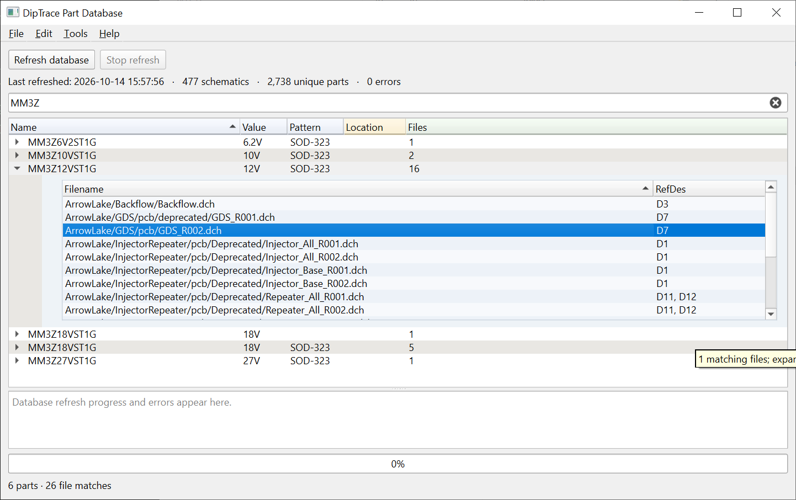
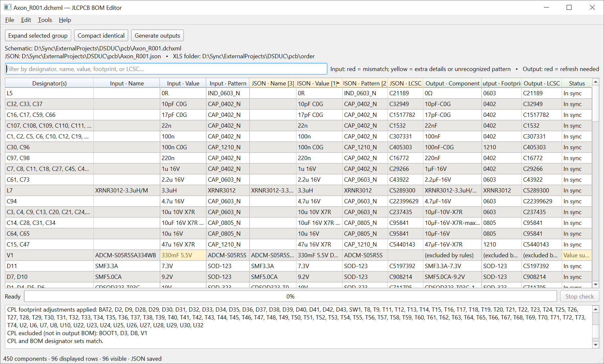
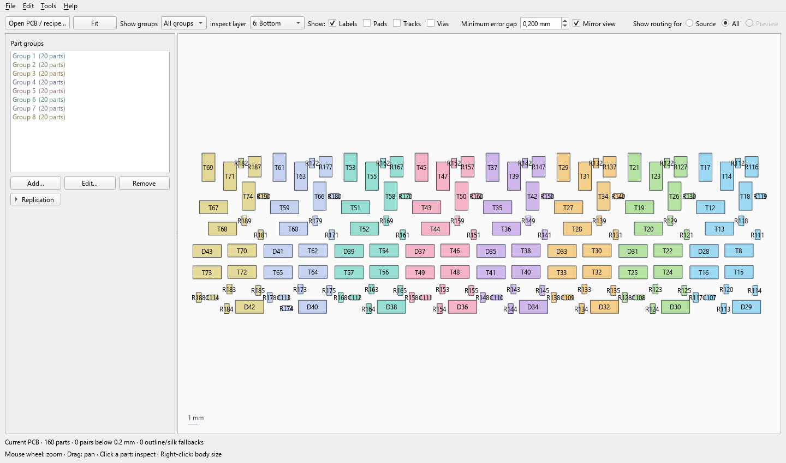

# DipTrace Tools

Three desktop tools for reusing DipTrace designs, preparing assembly orders and refining PCB placement. All use Python/PySide6, with launchers for Windows, macOS and Linux. Part_DB and JLCPCB_BOM share a configurable normalization language.

## Why these tools exist

**Part_DB** tracks historical use of parts, with optional storage locations. It helps you find parts used in the past, where they are stored, and which projects used them.

**JLCPCB_BOM** helps create, maintain, verify and back-annotate JLCPCB BOMs. It connects schematic data, editable project JSON and JLCPCB workbooks, so changes can be carried between design and ordering stages instead of re-entered. Schematic fields can be brought into JSON, JLCPCB selections can be read back into it, and edited Name/Value fields can be back-annotated into DipTrace.

**PCB_Layout** helps inspect placement feasibility using custom component body sizes and a configurable minimum placement gap. It also replicates complex patterns across a PCB: edit one group, then automatically generate or update the rest, including routing and vias.

## Part_DB

- **Turn design history into a reusable part library.** Find parts used in earlier designs and trace them to the exact projects, files and designators.
- **Find the physical parts too.** Keep drawer numbers or other storage labels beside each part, independently of schematic refreshes.
- **Search large archives quickly.** Normalize names, values and packages, search with wildcards, and reuse unchanged files instead of parsing the entire archive again.

Start **[Launch Part Database.cmd](Part_DB/Launch%20Part%20Database.cmd)**. Select a base folder and filter fields under **Tools → Settings**, then refresh. **Help → How to use** opens the user guide.



## JLCPCB_BOM

- **Maintain a BOM through the whole ordering cycle.** Bring schematic data into editable JSON, generate JLCPCB files, read back selected part numbers, and back-annotate edited Name/Value fields into DipTrace.
- **Keep primary parts and alternatives under control.** Save part choices and substitutes, then select which ones go into the next assembly order.
- **Generate consistent BOM and placement files together.** Part choices, normalization, exclusion rules and footprint corrections feed the assembly outputs; excluded parts disappear from both BOM and CPL.
- **See differences before ordering.** Compare the schematic, edited project data and generated BOM side by side, with mismatches highlighted.
- **Verify the actual supplier selection.** Read either JLCPCB workbook style and prepare product data plus configurable instructions for an AI checking pass, alongside RoHS information.

Start **[Launch JLCPCB BOM Editor.cmd](JLCPCB_BOM/Launch%20JLCPCB%20BOM%20Editor.cmd)**. Export a DipTrace XML schematic and a placement CSV in mm, inches or mils. **Help → How to use** explains the ordering and back-annotation workflow.



## PCB_Layout

- **Check whether a placement has room to assemble.** Use custom body sizes and a minimum placement gap to reveal crowded parts, with component outline or silkscreen fallbacks.
- **Edit one group and generate or update the rest.** Replicate complex placement patterns together with internal routing and vias, preserving destination nets when updating existing groups.
- **Explore arrangements without losing the current design.** Preview linear, grid or rotational placement and keep multiple reusable JSON recipes for one PCB.

Start **[Launch PCB Layout.cmd](PCB_Layout/Launch%20PCB%20Layout.cmd)**. Open a DipTrace PCB XML, choose a recipe JSON filename and add groups of RefDes. Replication controls stay folded away for ordinary viewing. **Help → How to use** explains body sizes, internal routing and export.



The central [component_sizes.json](PCB_Layout/component_sizes.json) starts with 0402 (1.05 × 0.55 mm), SOT23 (3.05 × 1.4 mm, 90° correction), and 0805 (2.2 × 1.4 mm) body rectangles from the reference viewer. Right-click a part to define a pattern, name, or combined match. Priority is **pattern < name < pattern + name**. Bodies are centered on the footprint origin, with optional additional X/Y offsets. The initial body gap is 0.2 mm; dimensions and gap can be changed. These are body checks, excluding pads and leads. Outline/silkscreen fallback checks are estimates.

## Defaults you can change

### Normalization

Each program has its own `normalization_rules.json`, opened through **Tools → Open normalization rules**. Both use the same engine and **Help → Normalization rule reference**. Rules support regex replacements, captures, conditions, fixed-text assignments, numeric formatting and assembly exclusion.

| Default behavior | Part_DB | JLCPCB_BOM |
| --- | --- | --- |
| Generic names | Clears exact `RES`, `CAP`, `IND`, ignoring case | Keeps names |
| Values | Formats R/C/L parts with Ω/F/H; preserves notes and unknown text | Preserves established R/C assembly formatting, including explicit resistance on other designators |
| Examples | `4k7 → 4.7kΩ`; `2u2 → 2.2µF` or `2.2µH` | Electronic shorthand, unit suffixes and micro notation are normalized for assembly |
| Footprints | Simplifies recognized package names to their four-digit size | Same simplification, configured in its own rules file |
| DNP/DNM | Keeps parts searchable | Excludes case-insensitive DNP/DNM tokens in Name or Value; **removes them from both BOM and CPL** |

Explicit resistance links such as `L5 = 0R` retain resistance units. Case-sensitive SI prefixes remain distinct (`m` versus `M`). Numeric formatting does not rescale equivalent spellings such as `100nF` and `0.1µF`. JLCPCB_BOM's defaults preserve its previous assembly behavior; adding custom rules can change it.

The default exclusion expressions treat spaces, tabs, slashes or field boundaries as token boundaries. They are rules in JSON, not fixed program decisions. Edit or disable them if your project conventions differ. Part_DB retains excluded assembly parts in its search database.

See [the rule-language reference](Shared/NORMALIZATION.txt) for syntax and examples. Refresh Part_DB after changing its rules; regenerate JLCPCB outputs after changing theirs.

### JLCPCB project settings

[project_defaults.json](JLCPCB_BOM/project_defaults.json) supplies settings **only when a project JSON is first created**. `{stem}` is replaced with the schematic filename without its extension. The resolved settings are copied into that project's JSON and can then be changed independently through **Tools → Open project settings JSON**.

| Project setting | Shipped template |
| --- | --- |
| `output_folder` | `./order` |
| `cpl_file` | `{stem}_CPL.csv` |
| `bom_file` | `{stem}_BOM.xls` |
| `cpl_output_file` | `{stem}_CPL.xls` |
| `cpl_decimals` | `3` |

**Tools → Open new-project defaults** changes these creation-time templates; existing projects retain their settings. Older project JSON files without output-name settings retain their previous filename conventions. Source CPL filenames must stay beside the schematic, and output filenames must end in `.xls`.

Placement CSVs accept mm, inches (`in`, `inch`, `inches`) and mils (`mil`, `mils`) specified in the X/Y headers. Coordinates are converted to mm before footprint corrections and written with three decimal places by default. Column names and ordering requirements are described in the user guide. Source CSVs are unchanged.

The global [AI check settings](JLCPCB_BOM/ai_check_settings.json) control the instruction text included in checker reports. [CPL adjustments](JLCPCB_BOM/cpl_adjustments.json) contain footprint placement corrections. Both are opened from Tools and can be customized independently of project filenames.

## Installation and repository contents

Keep `Part_DB`, `JLCPCB_BOM`, `PCB_Layout` and `Shared` as sibling folders in a writable location. Install Python 3.10 or newer, then the relevant dependencies (use `python3` on macOS/Linux):

```powershell
python -m pip install -r Part_DB/requirements.txt
python -m pip install -r JLCPCB_BOM/requirements-editor.txt
python -m pip install -r PCB_Layout/requirements.txt
```

| Platform | Launcher in each program folder |
| --- | --- |
| Windows | Double-click `Launch ….cmd` |
| macOS | Double-click `Launch ….command` |
| Linux | Run the program's `.sh` launcher, e.g. `sh "PCB_Layout/Launch PCB Layout.sh"`, from the repository root |

For downloaded copies on macOS, first run `chmod +x Part_DB/*.command JLCPCB_BOM/*.command PCB_Layout/*.command`. A virtual environment can be used on any platform; activate it before running a launcher from a terminal. On Linux, install your distribution's Qt desktop dependencies if Qt reports a missing platform plugin. A graphical desktop session is required.

Files open with the system's default application. Install or associate a suitable application for each file type; opening a schematic requires a handler for DipTrace files. Scanning, searching and generating outputs do not require DipTrace to be running. The macOS/Linux paths and launchers have automated dispatch checks, but have not been tested on native desktops yet.

Settings remain separate: Part_DB stores its preferences in `Part_DB/settings.json`; JLCPCB_BOM uses Qt's per-user settings (Windows registry, macOS preferences, or a Linux configuration file). Part_DB's `parts.json` and `part_locations.json` are local user data and are excluded from Git, along with supplier caches and generated reports.

PCB_Layout keeps recent/window preferences in `PCB_Layout/settings.json`, body dimensions in its central `component_sizes.json`, and study settings in user-named recipe JSON files. Opening a PCB prompts for a recipe filename; opening that recipe restores its PCB, groups and arrangement. Exported PCB XML must be re-imported into DipTrace. Outlines, pours and board graphics are retained rather than repeated with a group.

[PCB_Layout project defaults](PCB_Layout/project_defaults.json), available under Tools, are copied into new recipes. Changing those templates does not change an existing study.

DipTrace-ReverseEngineer is excluded from this repository. Part_DB includes the extracted structural parser it needs, so that source project is unnecessary at runtime. The detailed per-tool READMEs remain available for implementation and behavior reference.

The root screenshots are displayed at 720 pixels wide with their original proportions; the original image files are unchanged.
